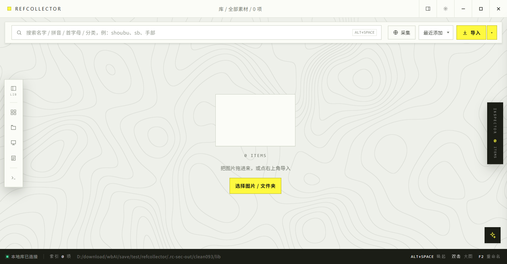
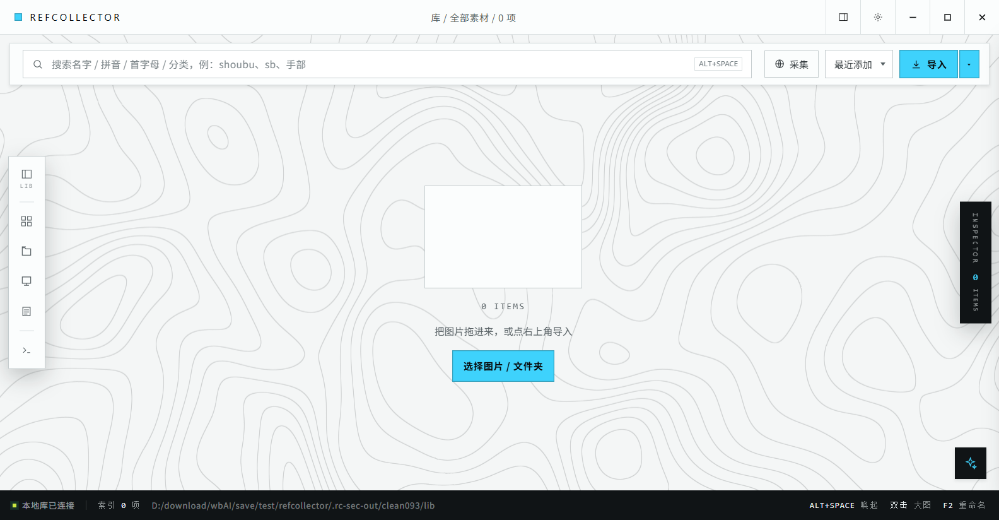
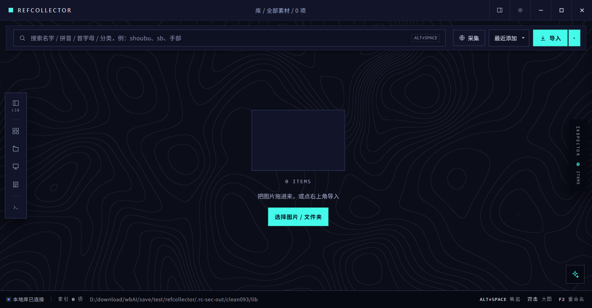
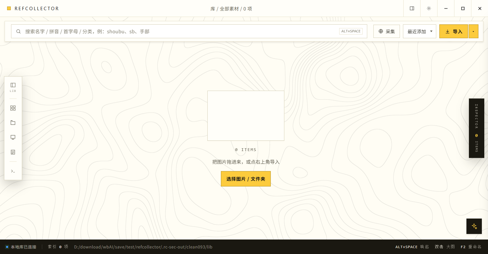
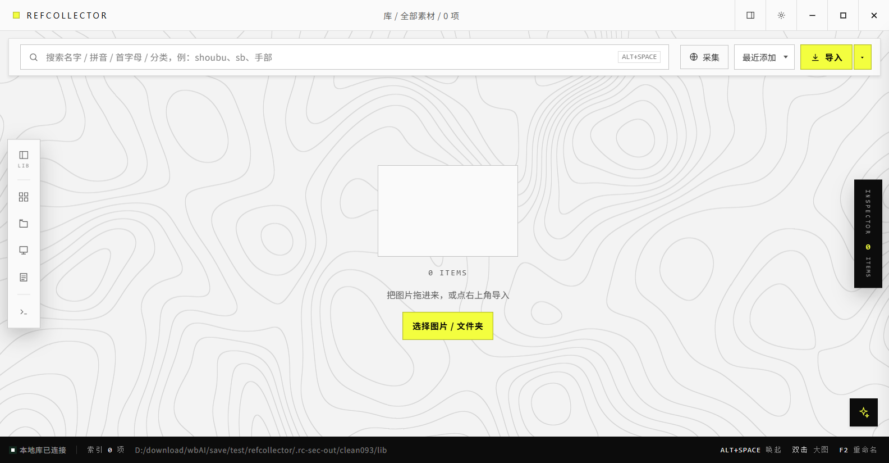
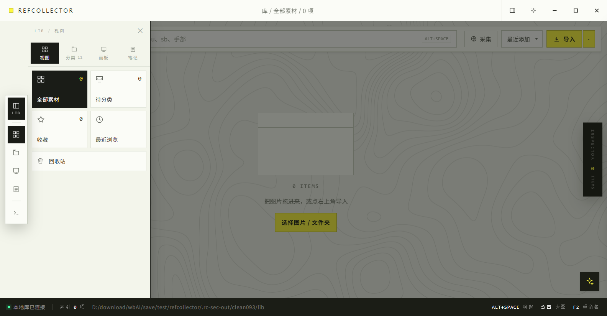
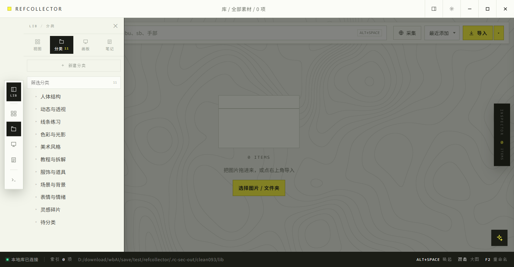
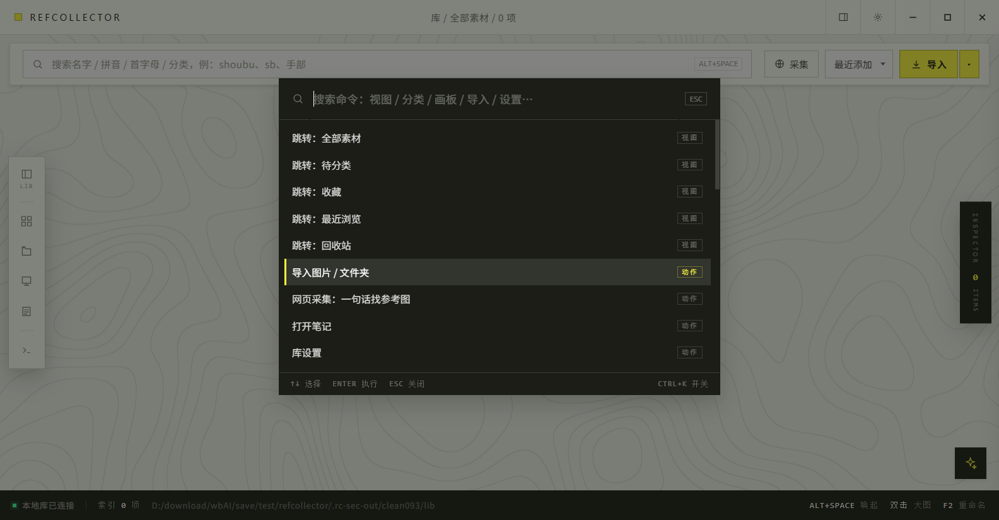

# RefCollector · 画师参考图收集器

<p align="center">
  
</p>

**Windows 桌面应用**。把网页上看到的、剪贴板里复制的、硬盘里已有的参考图，统一收进一个本地库：AI 视觉自动分类、拼音/取色/相似图搜索、画板与笔记整理、一键直送 Photoshop 画布。**全部数据本地存储，图片不出你的机器。**

`Electron 45` `React 18` `TypeScript` `SQLite (node:sqlite)` `ONNX CLIP ViT-B/32` 

> 本文所有截图都来自**空库**，不含任何用户素材。

---

## 🎨 界面风格从哪来

这套界面不是随手配的色，它有一条明确的参照线。

**基线：鹰角网络《明日方舟：终末地》的界面语汇**（开发期用 `data-ark-theme="endfield" data-ark-depth="complex"` 标定约束，见 [`design/legacy/参考图收集器-开发提示词.md`](design/legacy/参考图收集器-开发提示词.md)）。抽象出来的四条规则：

1. **全直角**——面板、卡片、按钮、胶囊、输入框、滚动条，`border-radius` 一律 0；需要"圆点"的地方改用 6px 方块。
2. **背景是素的**——窗口底只有一个平涂色，不铺环境光、不做全屏渐变、不加噪点和暗角。
3. **清透只发生在组件自身**——每块面板自己是极浅的竖向渐变，靠这一层"薄"显干净，而不是靠背景发光。
4. **信号色只做块面**——主按钮底、选中块、活动条用信号色实底；不在浅底上写彩色字。

排版借的是工业标识系统：等宽字做微标签（`LIB` / `INSPECTOR` / `001` / `ALT+SPACE`），中文用无衬线正文，信息靠 1px 细线分层。

空白画布铺的是**等高线地形图**——既是"收集参考"的地图隐喻，也让空库不至于是一片死白。等高线由 `topolines` 在 GPU 上绘制，禁用 GPU 时自动回退 SVG。

### 五套主题

同一套 token 换色，各自沿用对应作品的信号色；主题在 `设置 → 外观` 或命令面板里切换，无需重启。

| 主题 | 说明 | 预览 |
|---|---|---|
| **Endfield 现场**（默认） | 浅色、素底、信号黄 |  |
| **Ark 工业信息** | 浅色、冷灰、青蓝信号 |  |
| **Exa 午夜档案** | 深色、深夜蓝、青色高亮 |  |
| **PopuCom 波普** | 暖白、明快 |  |
| **Corporate 极简** | 灰白、克制 |  |

> 本项目是个人作品，与鹰角网络及其作品**没有隶属、授权或合作关系**，仅借用其公开界面语汇作为设计参照。

---

## ✨ 特性

**收集**
- 拖文件/文件夹进窗口即入库；剪贴板监听弹卡片一键存图；sha256 内容寻址去重
- 浏览器扩展（Chrome/Edge）：右键存原图、一键收集本页图片
- **网页采集 agent**：整句「我想要某站某角色的 30 张图」→ 解析/反问补全 → 自动遍历下载；遵守 robots.txt、诚实 UA、不带凭据、403 三连熔断、来源 URL 归档
- 导入时自动检测并裁掉白边（原图不动，可逆）

**整理**
- **CLIP 视觉自动分类**（零样本）+ **改判学习**：手动归类会作为 kNN 样本参与后续投票——归得越多，它越懂你的自定义分类；合成基准准确率 96%
- 规则层自动分类兜底；两级分类、画板（跨分类多对多）、笔记（可关联图片插图）、标签，全部支持拼音/首字母搜索
- 回收站软删除可恢复；橡皮筋框选 + 批量操作条

**浏览与取用**
- 交错瀑布流（按真实宽高比排布）、大图缩放平移、按住 Alt 取色、相似图、色板取色搜全库、置顶参考窗（可鼠标穿透）
- **直送 Photoshop 当前画布**（COM 集成，免拖拽；PS 未运行降级为复制）；拖出落点是原图
- GIF / 动态 WebP / APNG 真播放；全局热键可自定义；`Ctrl+K` 命令面板
- 右下角**离线问询助手**：怎么用直接问（内置 40 条知识库检索，LLM API 接入位预留）

**插件系统**
- 应用内插件（Node vm 沙盒 + 声明式权限：未声明的 API 在沙盒里不存在；三层防逃逸加固）
- 插件可注册命令面板命令（`Ctrl+K` 可见可执行）；设置页管理启停；内置「随机一图」「标签普查」两个示例
- 开发文档：[`docs/PLUGINS.md`](docs/PLUGINS.md)

**工程质量**
- 264 个 `node:test` 用例全绿；空白界面自动恢复；IPC / 渲染进程 / 崩溃统一错误日志
- 需求跟踪矩阵 [`docs/RTM.md`](docs/RTM.md)（29 条需求，27 条已交付）+ 多代理开发工作流沉淀 [`docs/WORKFLOW.md`](docs/WORKFLOW.md)
- 安全基线：窗口 `sandbox` + `contextIsolation`、外链只放行 http(s)、正式产物注入 CSP（`tests/security.test.mjs` 守着）

---

## 📦 安装（Windows 10/11 x64）

1. 下载 `RefCollector Setup 0.9.3.exe`（约 188 MB）。
2. 双击运行。若出现 **「Windows 已保护你的电脑」**（安装包未做代码签名）：点 **更多信息** → **仍要运行**。
3. 选择安装位置 → **安装** → **完成**。默认按当前用户安装，**不需要管理员权限**。
4. 卸载会**保留图库**；换版本直接覆盖安装即可。

- 默认库在 `图片\RefCollector`，可在 `设置 → 库与存储` 更换（支持连同现有素材整体迁移）
- CLIP 分类模型（两个量化 ONNX 文件，合计约 150 MB）在**首次使用 AI 分类时**从 hf-mirror 下载，之后完全离线
- 卸载后若想彻底清理，删掉 `%APPDATA%\refcollector` 即可（里面是配置、日志、模型缓存）

---

## 🚀 上手：从零到能用（步骤精确到按键）

下面假设你已经装好并启动。每一步都标出按键与位置。

### 1. 第一次启动

1. 应用打开即是空库，画布中央显示「0 ITEMS / 把图片拖进来，或点右上角导入」。
2. 想换库位置：点标题栏右侧 **齿轮图标** → 左侧选 **库与存储** → 点 **「更换 / 迁移 / 扫描接入…」** → 选新目录，再选 **复制并切换**（整体搬迁）或 **扫描并接入**（把新目录里已有的图片按文件夹归成分类）。
3. 想关窗口就收进托盘：`设置 → 通用 → 关闭到托盘`（默认开启）；退出请从托盘菜单选 **退出**。

### 2. 导入第一批图

任选一种：

- **文件夹/图片**：按 `Ctrl+O` → 在系统对话框里选中文件或文件夹 → 按 `Enter`；或直接把文件/文件夹**拖进窗口**任意位置。
- **指定分类导入**：点顶栏「导入」右侧的 **▾** → 先选目标分类，再选文件。
- **剪贴板**：在别处复制一张图 → 应用右下角弹出卡片 → 点 **存下**（或 **忽略**）。也可以随时按 `Ctrl+Shift+S` 手动存下当前剪贴板图片。
- **空库的黄色按钮**：点画布中央「选择图片 / 文件夹」效果与 `Ctrl+O` 相同。

### 3. 分类：默认 11 个，改到你顺手

1. 左侧 activity bar（竖排图标条）点 **文件夹图标**（分类）。
2. 点顶部 **＋ 新建分类** → 输入名称 → 按 `Enter`（`Esc` 取消）。默认已有：人体结构、动态与透视、线条练习、色彩与光影、美术风格、教程与拆解、服饰与道具、场景与背景、表情与情绪、灵感碎片、待分类。
3. **拖动卡片**到左侧分类行 → 松开即归类；拖动过程中左侧会整体切成「分类 + 画板」放置面板。
4. 批量改：框选或 `Ctrl+点击` 选中若干张 → 底部操作条点 **AI 分类**（模型自动判）或 **改分类到…** 下拉选目标分类。





### 4. 搜索与筛选

- 顶栏搜索框输入即可：支持中文名、拼音全拼、首字母（例：`shoubu`、`sb`、`手部`），跨分类、画板、笔记检索。
- 在**任何应用**里按 `Alt+Space`：唤起窗口并把光标直接放进搜索框。
- 左侧「视图」里可切：全部素材 / 待分类 / 收藏 / 最近浏览 / 回收站。
- 选一张图后，检查器里的色板可以**按色搜全库**；「相似图」按 CLIP embedding 找邻居。

### 5. 看图与取色

1. **双击**任意卡片 → 大图。
2. `←` / `→` 上一张 / 下一张；`+` / `-` 缩放；`0` 复位到 100%。
3. 按住 `Alt` 不放，在大图上**点击**取色，松开即复制该点色值。
4. `Esc` 退出大图，回到网格。

### 6. 取用：复制 / 置顶 / 进 PS

选中一张图，右侧 **检查器**（右缘 `INSPECTOR` 立牌，点击展开）：

- **复制图片**：点按钮，或直接到 PS 里 `Ctrl+V` 粘贴。
- **置顶**：开一个无边框小参考窗，可调透明度；按 `Ctrl+Shift+P` 切换**鼠标穿透**（画画时点不到它），再按一次收回。
- **直送 PS**：点「直送 PS / TO LAYER」把原图作为新图层贴进 Photoshop 当前画布（PS 没开则自动降级为复制）。
- **拖出**：按住底部操作条的「拖出」按钮不放，拖到 PS / SAI 窗口里插入原图。

### 7. 画板（跨分类的临时集合）

1. 左侧 activity bar 点 **画板图标** → **＋ 新建画板** → 输入名称 → `Enter`。
2. 把卡片**拖到画板行**加入（一张图可同时在多个画板）。
3. 点画板名进入该画板视图；批量条「加入画板…」也能加；检查器 `BOARDS` 里可单独移出。

### 8. 笔记

1. 左侧 activity bar 点 **笔记图标** → **＋ 新建笔记** → 输入标题 → `Enter`。
2. 检查器里点「＋ 新建笔记并关联」：建一条新笔记并把当前图作为插图塞进去。
3. 笔记与图片是双向的：可以在笔记里关联多张插图，也可以在检查器的 `NOTES` 区看到某张图被哪些笔记引用。笔记标题与正文都支持拼音搜索。

### 9. 命令面板（记不住入口就按它）

1. 按 `Ctrl+K` 打开。
2. 输入关键词（支持拼音/首字母，如 `zt` 或 `主题`）→ `↑` / `↓` 选择 → `Enter` 执行 → `Esc` 关闭。
3. 常用命令：导入、网页采集、库设置、切换某个分类/画板、切主题、收起右栏、打开问询助手。



### 10. 网页采集

1. 点顶栏 **采集**（`Ctrl+K` → 输入「采集」也行）。
2. 一句话描述，例如「我想要某站某角色的 30 张参考图」→ 按 `Enter` 发送。
3. 要素不全时它会反问，按提示补一句即可；下载前会确认合规参数。`Esc` 关闭面板会同时取消运行中的任务。

### 11. 浏览器扩展（Chrome / Edge）

1. 应用内 `设置 → 扩展与桥接` → 点 **打开目录**（内含 `extension` 文件夹）。
2. 浏览器地址栏输入 `chrome://extensions`（Edge 为 `edge://extensions`）→ 打开右上角 **开发者模式**。
3. 点 **加载已解压的扩展程序** → 选第 1 步打开的 `extension` 目录。
4. 回到应用复制 **令牌**，粘到扩展设置页 → 保存。

### 12. 问询助手

点右下角 **星形按钮**，直接问「怎么改全局热键」「相似图怎么用」；`Esc` 关闭。

---

## ⌨️ 快捷键

全局热键（任何应用在前台都生效）与应用内快捷键都可以在 `设置 → 快捷键` 里改；冲突的键位会标出并自动跳过。

| 键 | 作用 |
|---|---|
| `Alt+Space` | 唤起窗口并聚焦搜索（全局，可改） |
| `Ctrl+Shift+S` | 存下剪贴板图片（全局，可改） |
| `Ctrl+Shift+P` | 置顶参考窗鼠标穿透开/关（全局，可改） |
| `Ctrl+K` | 命令面板（可改） |
| `Ctrl+O` | 导入图片/文件夹（可改） |
| `Ctrl+A` | 全选当前视图 |
| `Ctrl` 点选 / `Shift` 点选 / 空白处拖框 | 多选 / 连选 / 橡皮筋框选 |
| `F2` | 重命名选中项 |
| `Delete` / `Backspace` | 移入回收站 |
| 双击卡片 | 大图（`←→` 切换、`+/-` 缩放、`0` 复位、按住 `Alt` 点击取色） |
| `Esc` | 逐层退出（面板 → 抽屉 → 选择 → 弹层） |

---

## 🗂 库目录

```
RefCollector/
  library.db             SQLite 元数据（WAL）
  files/ab/cd/<sha>.png  内容寻址原图
  thumbs/<sha>.jpg       缩略图
```

配置、日志、模型缓存在 `%APPDATA%\refcollector`，日志按天写入 `logs/rc-YYYY-MM-DD.log`，应用内 `设置 → 日志与诊断 → 打开日志` 可直接打开。

---

## 🛠 源码运行

```bash
git clone https://github.com/trash-avaliable/ArtCollector1024.git
cd ArtCollector1024/refcollector
npm install          # 国内网络建议加 --registry=https://registry.npmmirror.com
npm run build        # 构建前端到 dist/
npm start            # 启动桌面应用
```

> 终端若继承 `ELECTRON_RUN_AS_NODE=1` 会导致 Electron 退化为纯 Node，先 `set ELECTRON_RUN_AS_NODE=` 清掉（`start.cmd` 已自动处理）。

想先看效果：`set RC_LIB=%CD%\demo-library && start.cmd`，内置 10 张已分类示例图。

前端热更新：`npm run dev`（vite）+ `npm run dev:electron`。

## 🧪 开发

```bash
npm test           # 264 个 node:test 用例（含安全基线、UI 冒烟）
npm run rtm        # 重新生成需求跟踪矩阵 docs/RTM.md
npm run bench:clip # CLIP 分类基准（门禁 ≥90%，实测 96%）
npm run dist       # 打包 NSIS 安装包（国内加 ELECTRON_MIRROR 镜像变量）
```

代码结构：`electron/`（main / store / db / tools / clip / crawler / intent / scan / bridge / ps-bridge / palette / logger）、`src/`（React 界面，布局注册制见 [`src/lib/layout-registry.ts`](src/lib/layout-registry.ts)）、`docs/`（RTM 与工作流）。多代理并行开发的方法沉淀在 [`docs/WORKFLOW.md`](docs/WORKFLOW.md)。

## 🗺 路线图

见 [`docs/RTM.md`](docs/RTM.md)：29 条需求中 27 条已交付。剩余两项——**CLIP 语义搜索**（以文搜图，embedding 基建已就位）、**云同步 / 多设备**（需先解决 SQLite 多端写冲突，倾向只同步 `files/` 的内容寻址方案）。

## 📄 License

[MIT](LICENSE)
